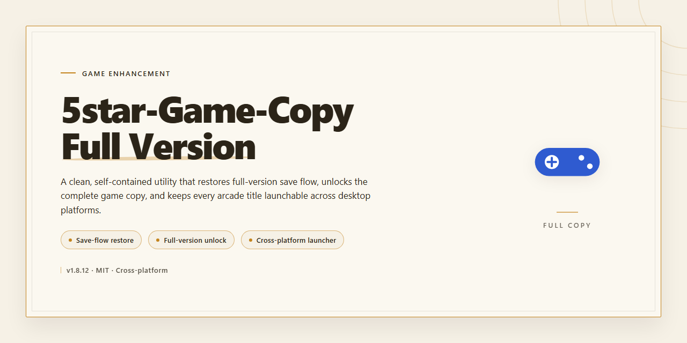

# 5star Game Copy — Full Game Backup Tool for Windows

### 💻 PowerShell Installer

    

---

5star Game Copy is a free full-version backup tool for Windows built for gamers who'd rather not gamble with their disc collections. It cuts straight through anti-copy protection on CD and DVD titles, and it doesn't flinch when sectors are damaged — the kind of discs most tools write off. The interface keeps things simple, so you spend your time backing up games, not fighting menus. If your library matters, this tool has your back.

## 📋 System Requirements

- **OS:** Windows 10 / 11
- **Shell:** PowerShell 5.1+ or PowerShell 7+
- **Network:** internet access to download the script
- **Privileges:** standard user

## Features

- **Full disc backup engine** — copies your entire game disc to a local image or folder, so your original stays on the shelf and your backup takes the wear.
- **Anti-copy protection bypass** — skips the copy protection schemes baked into protected CD and DVD titles, the exact thing that makes ordinary copy tools choke and quit.
- **Damaged sector handling** — reads past scratched, corrupt, or unreadable sectors instead of aborting the job, so a beat-up disc still has a shot at a clean backup.
- **Bad sector retry and skip logic** — keeps grinding on problem areas, then moves on, so one nasty scratch doesn't kill the whole rip.
- **Simple menu-driven interface** — pick your drive, pick your method, hit go. No config files, no command line, no guesswork.
- **Multiple backup methods** — choose the copy approach that fits the disc in front of you instead of a single one-size-fits-all pass.
- **Broad CD/DVD format support** — handles the disc types your game library actually uses.
- **Windows-native build** — runs on Windows 10 and 11, x64 and x86, with a light footprint (1 GB RAM, 100 MB storage, 1 GHz CPU).
- **Personal-use focus** — built for backing up games you legally own, so your library survives scratches, lens wear, and time.
- **No feature locks** — the full version ships unlocked; every capability listed here is available out of the box.

## How it works

5star Game Copy works at the disc level, not the game level. It reads the raw sector data off your CD or DVD and writes a faithful image to your drive — so the backup behaves exactly like the original, protections and all.

The engine is built around three moves:

- **Sector-level reading** — Instead of trusting the file system, it pulls every sector directly from the disc. That's what lets it see structures the OS normally hides.
- **Anti-copy bypass** — Copy protections work by planting intentionally malformed sectors and checks that a normal reader chokes on. 5star Game Copy detects those traps, skips past them, and keeps the read stream alive instead of stalling out.
- **Damaged-sector handling** — Scratched or aging discs throw read errors that kill most copy jobs. The tool retries, re-reads, and reconstructs those sectors so one bad spot doesn't take down the whole backup.

Once the read completes, the data is written out using your chosen backup method — pick the one that matches your disc type and drive for the cleanest result. The whole pipeline runs from a single menu: select your source, select your target, choose your method, go.

No background services, no drivers, no always-on processes. It reads, it writes, it's done.

## Supported Games

5star Game Copy is built to handle the real-world mess of physical game media, and the supported games list reflects that. Rather than chasing a whitelist of titles, the tool targets the copy protection schemes themselves — which means if your game ships on a disc, there's a solid chance it's covered.

### What Works

- **PC CD/DVD game discs** — The core target. Standard-issue disc-based titles back up cleanly, including those wrapped in common anti-copy protection layers.
- **Discs with damaged sectors** — Scratched, scuffed, or otherwise worn discs that other tools choke on are exactly where 5star shines. It reads around bad sectors and keeps going.
- **Multiple CD/DVD formats** — Various disc formats are supported, so your collection doesn't need to fit one narrow profile.
- **Multi-disc titles** — Games spanning several discs are handled disc by disc, so nothing gets left behind.

### What to Know

- **Physical media only** — This isn't a digital-download or online-only game tool. If there's no disc, there's nothing to copy.
- **Protection-dependent results** — Coverage is defined by the anti-copy system a title uses, not by publisher or genre. The full version ships with all protection handling enabled, so you're not locked out of anything behind a paywall.
- **Personal backups only** — The supported list assumes you own the original disc. Back up what you bought; that's the whole point.

Bottom line: if it's a disc-based Windows game and you're backing up your own copy, 5star Game Copy is built to get it done — damaged sectors and all.

## Configuration

5star Game Copy runs clean out of the box — no scripts to edit, no config files to hand-craft, no dependencies to wire up. Fire it up and it's ready to rip. Still, a few settings decide whether your backup flies or crawls, so tune them before you hit start.

**Backup Method** — This is the big one. Pick the method that matches your disc's condition. Clean disc? Go with the fastest pass. Scratched or showing damaged sectors? Switch to the sector-skipping method so the tool pushes past bad reads instead of stalling out. Match the method to the media, not the other way around.

**Read Settings** — When discs are rough, lower the read speed. Slower reads give the drive more retries per sector and cut down on hard errors. Bump it back up on healthy media to save time.

**Damage Handling** — Decide up front how the tool treats unreadable sectors. You can have it skip and log them for a usable backup, or push for maximum recovery and accept a longer run. Skim-and-log is the practical default for most discs.

**Destination & Image Format** — Point your output at a drive with headroom — a full disc image runs large. Keep the default image format unless you've got a specific reason to change it; the defaults are tuned for compatibility.

**Drive Selection** — Got more than one optical drive? Confirm you're reading from the right one before you start. Sounds obvious. It still burns people.

**Output Verification** — Leave verification on. It's the difference between "I made a backup" and "I made a backup that actually works."

**Pro tip:** Test your settings on a single disc first. Dial in the method and read speed that fit your collection, then batch the rest.

## FAQ

**Is 5star Game Copy really the full version?**

Yes — the full version. No locked features, no watermark, no "upgrade to unlock" nonsense. What you grab is the complete toolset for backing up your games.

**Does it actually handle damaged discs?**

That's the headline feature. Discs with damaged sectors that make other tools choke are exactly what 5star Game Copy was built for. If your disc has read errors, this is where it earns its keep.

**Which games are supported?**

CD and DVD-based games with anti-copy protection are the target. If your collection lives on optical media, you're in the right place.

**What do I need to run it?**

Windows 10 or 11, x64 or x86 architecture, 1 GHz processor, 1 GB RAM minimum, and about 100 MB of free storage. Modest specs — it's not a resource hog.

**Is it safe?**

The installer is scanned and verified before it ships. No bundled junk, no shady payloads. Download it, run it, back up your games.

**Do I need to be tech-savvy to use it?**

No. The interface is straightforward — pick your method, point it at the disc, let it work. The multiple backup methods give you flexibility without forcing you into a manual.

**What's the catch with the free version?**

No catch. It's freeware, full functionality included. The only rule: use it to back up games you actually own.

**Will it work on my old disc that keeps failing?**

That's the scenario it's designed for. Damaged sectors don't stop it — it bypasses the problem areas and pulls what it can. Give it a shot before you write that disc off.

## Disclaimer

5star Game Copy is built for one job: backing up discs you actually own. It is not a distribution tool, not a piracy kit, and not a workaround for borrowing your buddy's library. Use it on games you purchased, for personal archival purposes only — that's the line, and it doesn't move.

Bypassing anti-copy protection is legally murky in plenty of jurisdictions, and the rules vary hard from country to country. You are responsible for knowing what's legal where you live before you run this thing. Nothing in this project grants you rights you didn't already have.

The software is provided as-is, with no warranty of any kind — express or implied. Backup quality depends on your drive, your discs, and your setup. Damaged sectors get handled as well as the hardware allows, but no tool on the planet can promise a perfect read from a physically wrecked disc. Test your backups before you trust them.

5star Game Copy is not affiliated with, endorsed by, or sponsored by any game publisher, console manufacturer, or disc-protection vendor. All trademarks belong to their respective owners. You assume full responsibility for how you use the tool and for any consequences that follow. Back up smart, stay legal, and keep your library yours.